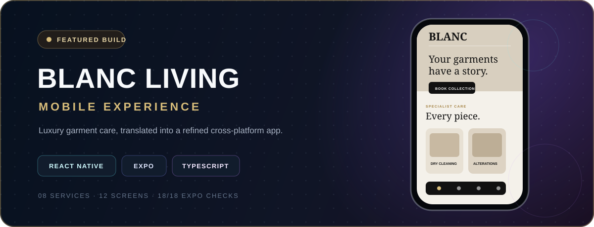

  

  <h2>Thoughtful products. Clean engineering. Polished details.</h2>

  
I build mobile apps and web experiences that feel good to use and hold up behind the scenes.

  

    <a href="#featured-work">Featured work</a> ·
    <a href="#what-i-build">What I build</a> ·
    <a href="#toolbox">Toolbox</a> ·
    <a href="#connect">Connect</a>
  

---

## Hey, I'm Ibrahim 👋

I'm a full-stack and mobile developer working across **React Native, Expo, React, TypeScript, Python, Django, and WordPress**. I like turning a complicated workflow into something people can understand at a glance.

My work spans customer-facing apps, business tools, and content-driven websites. I also explore machine learning and deep learning when they can make a product more useful.

## Featured work

### [BLANC Living Mobile →](https://github.com/benzibrahim/blanc-living-mobile)

A mobile experience for a luxury garment-care service. I built the app with **React Native, Expo, and TypeScript**, including service discovery, collection booking, account flows, and reusable interface components.

| More projects | What they do |
| :--- | :--- |
| **[PackifyBoxes →](https://github.com/benzibrahim/packifyboxes)** | A packaging website with a filterable product catalog, buying guides, and a quote request flow. |
| **[Solar System Time Engine →](https://github.com/benzibrahim/solar-system-time-engine)** | An interactive experiment that explores time and motion in the solar system. |

## What I build

| 📱 Mobile experiences | 🧩 Full-stack products | ✨ Clear interfaces |
| :--- | :--- | :--- |
| Cross-platform apps with considered navigation, responsive layouts, and smooth flows. | Practical tools with dependable data handling and maintainable code. | Visual systems that make complex tasks feel simple and focused. |

## Toolbox

| Area | Tools I use |
| :--- | :--- |
| **Mobile & frontend** | `React Native` `Expo` `React` `TypeScript` `JavaScript` `HTML` `CSS` |
| **Backend & content** | `Python` `Django` `WordPress` |
| **Workflow** | `Git` `GitHub` `VS Code` |
| **Exploring** | `Machine learning` `Deep learning` |

## How I work

1. **Understand the real task.** Map the people, steps, and edge cases before shaping the interface.
2. **Build the useful core.** Make the flow clear, the data dependable, and the code easy to extend.
3. **Polish the details.** Refine the states, spacing, speed, and language people notice every day.

  

## Contributions

<picture>
  <source media="(prefers-color-scheme: dark)" srcset="https://raw.githubusercontent.com/benzibrahim/benzibrahim/output/github-contribution-grid-snake-dark.svg" />
  <source media="(prefers-color-scheme: light)" srcset="https://raw.githubusercontent.com/benzibrahim/benzibrahim/output/github-contribution-grid-snake.svg" />
  
</picture>

## Connect

Have a mobile app, website, or product idea in mind? Explore my [public projects](https://github.com/benzibrahim?tab=repositories) or reach me through [GitHub](https://github.com/benzibrahim).

Made with care by Ibrahim Yousaf.

